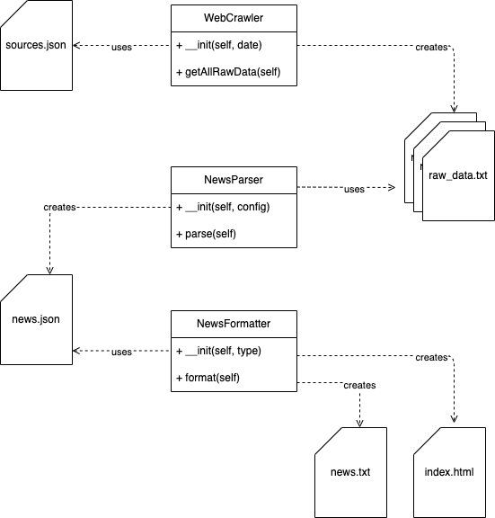

# PyNews

A Python news aggregator that collects the latest headlines from several regional news portals, normalises them into a single dataset and exports the result as an HTML page, a plain-text digest and a CSV file.

## How it works

The pipeline has three stages, each implemented as its own class:

1. **`WebCrawler`** (`web_crawler.py`) reads the list of sources from `sources.json` and downloads the raw content of each source into `temp_files/`.
2. **`NewsParser`** (`news_parser.py`) extracts the title, description, publication date and link of each article. It handles three different source formats:
   - RSS/XML parsed with `xml.etree.ElementTree`
   - RSS feeds parsed with `feedparser`
   - plain HTML pages scraped with `BeautifulSoup`, including a follow-up request to each article page to fetch its first paragraph

   All articles are merged into a single `news.json` file.
3. **`NewsFormatter`** (`news_formatter.py`) turns `news.json` into:
   - `output/index.html` – a Bootstrap page with one card per article
   - `output/news.txt` – a plain-text digest with normalised dates
   - `output/news.csv` – a CSV file (`title, description, link, date`) ready for further analysis

## Configuration

- `sources.json` – list of sources (`tag`, `description`, `address`). New sources can be added here.
- `settings.json` – `number_of_news_per_source` controls how many articles are taken from each source.

## Running

```bash
pip install -r requirements.txt
python main.py
```

The generated files appear in the `output/` folder.

## Project structure

```
├── main.py              # Entry point – runs the whole pipeline
├── web_crawler.py       # Fetches raw data from the sources
├── news_parser.py       # Parses XML, RSS and HTML into a common format
├── news_formatter.py    # Exports news to HTML, TXT and CSV
├── custom_print.py      # Console logging helper
├── sources.json         # News sources
├── settings.json        # Parser settings
├── docs/                # Generated pydoc documentation
└── uml/                 # UML class diagram
```

## Design



## Technologies

Python 3, BeautifulSoup, feedparser, requests, python-dateutil, ElementTree, csv, json
